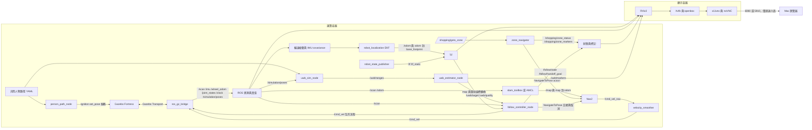
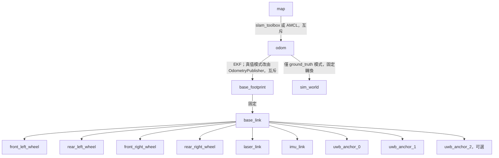

# 系統架構

運算容器處理 Gazebo Fortress、感測器橋接、TF、SLAM、Nav2、區域導航及 UWB 跟隨；顯示容器只執行 Xvfb、openbox、VNC／noVNC 與按需啟動的 RViz。兩者在相同橋接網路使用 Fast DDS UDPv4，相同領域編號；不依賴跨容器共享記憶體。

`sim`、`mapping`、`guide` 與 `follow` 都接受 `odom_source:=ekf|ground_truth`，預設 `ekf`，不支援執行途中切換。兩種模式都保留原始 `/wheel_odom` 與 `/sim/ground_truth_odom`；後者框架為 `sim_world → base_footprint_gt`。其 Gazebo TF 主題 `/sim/ground_truth_tf` 不橋接；DiffDrive 的 `wheel_tf` 也不橋接，避免同一車體有多個 TF 來源。

| 模式 | `/odom` 與 `odom → base_footprint` 唯一來源 | 世界座標關係 |
| --- | --- | --- |
| `ekf`（預設） | `robot_localization/ekf_node`，40 Hz、`two_d_mode: true`、`world_frame: odom` | 不發布 `odom → sim_world`；真值不接入估測 TF 樹 |
| `ground_truth` | 額外啟用舊 OdometryPublisher 與 `bridge_ground_truth.yaml` | 保留舊 `odom → sim_world` 單位轉換 |

用兩個橋接檔隔離真值模式專用的 `/odom`、`/tf`，並以相同 `odom_source` 條件控制 xacro 舊真值外掛與 launch 節點，避免 EKF 與模擬器同時發布車體 TF。真值模式有獨立的診斷真值外掛與舊輸出外掛，兩者使用相同模擬位姿。

EKF 設定安裝於 `shopping_robot_gazebo/config/ekf.yaml`，僅融合 `/wheel_odom_noisy` 的 vx、vyaw 與 `/imu/with_covariance` 的 vyaw；輪式位置是相同編碼器資料的積分，不重複融合。六軸 IMU 沒有磁力計或外部航向基準，因此排除模擬器提供的絕對 orientation，也不融合加速度；yaw 仍會隨陀螺儀偏差漂移。此選擇依 [robot_localization 感測器設定說明](https://github.com/cra-ros-pkg/robot_localization/blob/humble-devel/doc/configuring_robot_localization.rst)，參數順序依 [Humble EKF 範例](https://github.com/cra-ros-pkg/robot_localization/blob/humble-devel/params/ekf.yaml)。

IMU 三軸角速度使用標準差 0.005 rad/s、偏差平均幅度 0.0005 rad/s、偏差標準差 0.0001 rad/s；三軸加速度分別為 0.05 m/s²、0.01 m/s²、0.002 m/s²。偏差由 Gazebo 抽樣，正負號可能不同，並非指定固定正偏差；格式依 [SDFormat 感測器規格](https://sdformat.org/spec/1.6/sensor/)。`wheel_odom_noise` 使用 ROS-free `odom_noise.py`，預設種子 42、線速度比例 1.01、角速度比例 1.02、Gaussian 標準差 0.01 m/s 與 0.02 rad/s；這些都是同名節點參數。種子只控制此 Python 輪速噪聲序列，不控制 Gazebo IMU 或物理引擎。輪速融合 covariance 下限為 0.02² 與 0.10²，對滑移角速度保留較大不確定度，讓陀螺儀主導偏航速度。節點同時保留 `/imu` 的時間戳、框架與量測，輸出角速度 covariance 0.005²、加速度 covariance 0.05²，orientation covariance 首項為 −1，避免橋接器回傳零 covariance 或模擬絕對朝向被誤用。`/wheel_odom_noisy` 的 pose 保留原始輪式積分值，只有 twist 加噪，不能把該 pose 當成加噪速度的積分結果。

`odom_drift_monitor` 在兩種模式都啟動，將 `/sim/ground_truth_odom` 以相鄰時間戳線性插值到 `/odom` 時間（yaw 取最短角），最多跨 0.1 秒，不外插。資料過期 0.5 秒後不再發布；時間倒退會清空歷史。每 5 秒記錄並發布 `/sim/odom_drift`（Float32MultiArray），順序為平移誤差 m、絕對最短航向誤差 rad、累積真值路程 m、平移誤差 m/m、航向誤差 rad/m。路程為已配對樣本間真值平移距離總和，未移動時兩個每公尺指標為 NaN；純旋轉不能用每公尺指標評估。ROS-free `odom_metrics.py` 可直接處理時間對齊的 `Pose2`。目前比較共用出生原點的座標，不做事後最佳對齊；更改出生姿態、重啟 EKF 或中途啟動監測器時需自行處理原點與統計期間，不能把初始偏移當作漂移性能。

RViz 設定只顯示 `base_link` 下的 UWB 估測標記，沒有依賴 `sim_world` 的顯示項目，故不需更動。`/uwb/person_ground_truth` 仍可供程式評估或記錄；在 EKF 模式若要直接顯示世界真值，須另開以 `sim_world` 為固定框架的檢視，不應新增假的單位 TF。

`follow` 現在同時啟動 SLAM 與 Nav2，預設使用線上建圖，亦可透過 `slam_mode`／`map` 選擇定位。RViz 預設仍為 `odom`；需要顯示地圖與交接目標時改為 `map`。模擬原點為機器人初始平面位置 `(0, 0)`，朝向正 x。展示場景為 12 × 10 公尺的小型模擬商店，四排貨架中心 x = −3.6、−1.2、1.2、3.6，皆涵蓋 y = 1 至 5，寬 0.8 公尺。三條貨架間走道中心為 x = −2.4、0、2.4，淨寬皆為 1.6 公尺，大於 1.2 公尺需求；車寬 0.50 公尺與 0.55 公尺膨脹半徑可容納於走道。前後橫向通道位於 y = 0 與 5.9。南側 y = −3 留寬 2 公尺入口，結帳櫃臺位於 `(4.5, −1)`，導航目標在櫃臺西側 `(3, −1)`。

機器人明確以世界姿態 `(0, 0, 0.02)`、roll／pitch／yaw 皆為 0 出生；0.02 公尺為落地餘量。`odom` 初始平面原點與世界一致，`map` 使用此起點建圖；定位時也須載入相同座標的地圖與初始姿態。六個 `map` 區域目標位於三條走道與入口／結帳前的自由空間。純 Python 測試直接解析 SDF 的實際碰撞盒，檢查四排／三走道數量、寬度、出生點的 0.7 公尺淨空、雷射前方 ±30 度至 0.7 公尺的自由空間與每個目標的 0.55 公尺淨空，以及人物每個航點和整段循環路徑的 0.30 公尺淨空，避免另外維護一份失同步的配置。

## 套件與介面

| 套件 | 責任 |
| --- | --- |
| shopping_robot_description | 車體尺寸屬性、四輪關節、雷射、IMU 與錨點 TF |
| shopping_robot_gazebo | 世界、人物路徑、模擬啟動、單向橋接設定 |
| shopping_robot_slam | 非同步建圖、序列化位姿圖定位 |
| shopping_robot_navigation | Humble Nav2、Regulated Pure Pursuit、代價地圖、速度平滑、可選 AMCL |
| shopping_robot_bringup | 互斥使用的建圖／引導／跟隨入口與 RViz |
| shopping_zone_manager | 區域資料驗證、別名查詢、NavigateToPose 動作客戶端及離線評估報表 |
| shopping_uwb_follow | 測距、平面估測、濾波、控制及人物位姿模擬節點 |

### 區域導航狀態與取消

`shopping_zone_manager/goal_tracker.py` 為不匯入 ROS 的狀態機；`node.py` 負責執行送出與取消效果。世代計數器將接受、結果、取消回覆綁定至同一個目標，舊世代事件不會覆寫目前狀態。流程為 `IDLE → PENDING → ACTIVE → SUCCEEDED／ABORTED`，拒絕目標為 `REJECTED`；取消經過 `CANCELING`，直到 action result 才回報 `CANCELED`。取消遭拒或通訊例外回報 `CANCEL_FAILED` 並保留忙碌狀態，不能視為已停止。

常駐節點統一處理 `/shopping/goto_zone`，`goto_zone` 不再自行送 action，因此共用預設 `BUSY` 政策。節點參數 `preempt` 預設為 `false`，啟用後只保留最新排隊要求，舊動作結束後才送新目標；取消失敗或接受回覆逾時會清除排隊要求。`UNKNOWN_ZONE` 與 `UNAVAILABLE` 不送 action，忙碌時的新要求不改變舊目標生命週期。`/shopping/zone_status` 使用 `CODE: text`，`ACTIVE` 的距離回饋限速約 1 Hz；`/shopping/cancel`（Empty）與 `/shopping/cancel_goal`（Trigger）共用非阻塞取消流程。

`response_timeout` 預設 5 秒，以單調時間判定；推進狀態的計時器使用穩定時鐘，即使模擬暫停仍能回報 `TIMEOUT`。目標姿態與標記時間戳仍使用一致的 `use_sim_time`。尚未接受時要求取消，收到 handle 後立即取消；逾時亦保留 future 與未結束標記，延遲接受的 handle 立即取消，直到舊請求確定結束才允許新目標。若 DDS 永遠不回覆，無法取得 handle，也無法證明已停止，因此保持忙碌，需維護者檢查 Nav2。遺失結果時同樣保留 handle 供後續取消，不自行假定成功。

`goto_zone --timeout`（預設 300 秒）保留 Nav2 伺服器 15 秒等待上限，並在 Ctrl-C／期限到達時要求取消、有限等待結果；`cancel_zone` 的服務成功只表示已處理要求。共用狀態主題沒有呼叫者識別碼，目前限定單一互動呼叫者。`nav_action_check` 在專用模擬操作時段使用同一 adapter 的獨立實例，不建立第二組指令／服務端點，以 map 座標 `(50, 50)` 作為不可達目標（`unreachable goal`），讀取安裝版 NavFn 容許值，確認與 SDF 牆面所圍商店外框及實際全域成本地圖外框的距離皆超過容許值加 1 公尺；再要求 `ABORTED`／`REJECTED`，保留單項逾時取消。以 `/odom` 確認取消後停止，預設輸出五項檢查表。`--tolerance-check` 增加正常區域抵達誤差檢查，成功結果後取得新鮮 `/odom`，預設誤差上限 0.35 公尺（`--max-final-error` 可調），表格列出誤差；直接比較 odom 與 map，限模擬原點對齊且漂移可忽略時使用，不補償 map→odom 修正。常駐管理器須保持閒置，且不得同時執行跟隨、鍵盤或其他 action client。其離線語法檢查與狀態機 pytest 不取代 Humble 容器建置及 Gazebo 驗收。

`/uwb/ranges` 是 Float32MultiArray，順序對應 `anchor_x/anchor_y`，單位公尺，NaN 表示掉包；無額外時間戳，僅限目前模擬。`/uwb/target` 為 base_link 下的 PointStamped，x 向前、y 向左；`/uwb/quality` 是 Float32，三錨點的基準值為 1、兩錨點為 0.5，再依測距殘差降低。這不是校準過的統計機率。

三錨點使用平方距離差線性解加上 Gauss–Newton 修正；兩錨點解兩圓交點，有前後歧義。啟動時選前半平面，之後選最接近前次估計的位置；錨點預設沿左右方向配置，任意旋轉配置不保證可單靠前半平面消除歧義。平滑濾波在資料過期或時間倒退後重設。控制節點使用目標時間戳偵測過期，50 毫秒更新；超過 0.5 秒沒有有效目標或雷射便停止。

`sim`／`mapping`／`guide` 預設 `person:=false`，人物初始停放店外 `(20, 20)` 且不啟動路徑節點；明確傳入 `person:=true` 才移入路徑。`follow` 固定啟用人物，路徑起點為 `(1.5, 0)`，首段沿 y = 0 的自由橫向通道向 +x 移動。人物圓柱透過 Fortress `set_pose` 服務每 0.1 秒更新，UWB 以同一份路徑與絕對模擬時間計算人物位置；Gazebo 顯示可能有一個更新週期的延遲。機器人位置取 SceneBroadcaster 的真實模型位姿（橋接至 `/simulation/poses`），不使用可能受滑移影響的輪式里程計作測距真值。`/uwb/person_ground_truth` 使用 `sim_world`。更換世界、模型名稱或初始機器人位置時須同步修改此對應與漂移評估的原點假設。

`follow_metrics.py` 為不匯入 ROS 的評估模組：`FollowSample` 記錄時間、base_link 估測、共用世界框架下的平面車體姿態與人物真值；`sample_metrics` 將估測旋轉平移後計算歐氏誤差及真實跟隨距離。`evaluate_series` 對遞增時間序列產生按樣本加權的誤差平均／RMSE／最大值、距離平均／最小／最大值及樣本數與期間，空序列或非有限資料會拒絕。

`follow` 同時啟動 `uwb_eval_node`，使用最新 `/sim/ground_truth_odom`、`/uwb/person_ground_truth` 及 `/uwb/target`，三筆時間戳最大差不超過 `max_skew`（預設 0.15 秒）才發布 `/uwb/estimate_error`（Float32，公尺）；缺資料、過期或座標框架不符時略過。車體與人物真值皆在 `sim_world`，直接用真值車體姿態轉換估測，不依賴 TF，也不包含 EKF 漂移；仍不插值，因此結果包含取樣時間差及濾波延遲。人物真值仍為共用路徑的解析值，非圓柱服務實際到位的回報。

## 跟隨與 Nav2 交接

`follow_handoff.py` 不匯入 ROS，負責視線幾何與 DIRECT／NAV2 狀態；控制節點保留原本直接跟隨狀態名稱，導航持有控制權時發布 `NAV2_HANDOFF: 原因`；視線受阻、尚未交接時發布 `BLOCKED_WAIT` 並輸出零速。跟隨 launch 固定啟用人物，同時載入 `navigation.launch.py`，不啟動 `zone_navigator`。全流程使用相同 `use_sim_time`；map→odom 仍由所選 SLAM／定位來源單獨發布。

有效且距離大於 `follow_distance + handoff_margin`（1.3 公尺）的目標，在 OBSTACLE_STOP 或視線遮擋持續 `handoff_delay`（1 秒）後交接。LOS 檢查從雷射原點到人物的半寬 0.25 公尺走廊，至少包含最近方位射線；障礙距離小於人物距離減 `los_margin`（0.35 公尺，涵蓋人物半徑 0.25 公尺與估測餘量）才阻擋。正無限遠視為暢通，低於量測下限視為阻擋；空掃描、NaN、負值、超過有限上限或無效角度視為失效。節點以量測時間查詢 TF，將 base_link 目標轉到雷射框架，避免忽略雷射前移 0.18 公尺；map←base_link 不可用時不交接，導航中轉換失敗則取消。這些是平面轉換，適用目前地面模擬。

NavigateToPose 目標為人物本身的 map 座標，朝向由車體指向人物。人物相對上次送出目標移動超過 0.4 公尺，且已經過 0.5 秒才更新；直接送出新的 NavigateToPose，由 bt_navigator 搶占執行中的目標，不取消、不等待停止。節點以世代編號追蹤目前目標，忽略已取代目標的接受／拒絕回覆、結果、取消確認與傳輸例外；這些回呼不得更改目前目標控制代碼、導航狀態、失敗冷卻或第一筆直接命令。舊目標延遲收到接受回覆時也不補送取消，以免干擾目前導航。`/follow/handoff_goal` 發布實際送出的 map PoseStamped。為容納人物占據的格子，共用 NavFn `tolerance` 從 0.3 提高為 0.8 公尺，讓規劃器尋找附近自由終點；未偏移目標。引導模式也使用此容差，受阻區域目標可能在 0.8 公尺內的其他位置結束，必須核對實際終點，不能只看成功回報。動態人物與終點容差的實際互動仍待模擬驗收。

視線暢通且前方淨空大於 0.8 公尺持續 0.5 秒，或視線暢通且人物距離不超過 1.3 公尺，或導航成功，便取消並切回 DIRECT。目標遺失／過期、過近、停用、雷射失效會立即取消並發布零 Twist；導航拒絕、失敗或非預期取消則切回直接控制，冷卻 3 秒後才重新累計受阻時間。`route_around:=false` 保留原本直接控制，不建立 ActionClient 或 TF listener。

速度互斥以動作生命週期執行：NAV2 期間直接控制器不發布 `/cmd_vel`，由 Nav2 的 velocity_smoother 輸出；安全事件切回 DIRECT 後可立即發布零命令。取消回覆不代表已停止，須等終止結果；若仍在等待送出回覆，收到接受結果後補送取消。僅 NAV2→DIRECT 交接進入速度排空等待；確認目標終止後，若外部 `/cmd_vel` 已安靜至少 0.3 秒，或最新外部命令符合 `|v| < 0.02 m/s` 且 `|w| < 0.05 rad/s`，便可恢復直接發布。終止確認後最多再等 2 秒，即使仍收到非零命令也恢復；此上限不允許略過目標終止確認。沒有收到命令時自交接開始計算安靜時間。節點訂閱 `/cmd_vel`，依訊息發布端 GID 與自身節點發布端資訊排除自身命令，包含延遲收到的安全零速。排空判斷放在不匯入 ROS 的 `VelocityDrain`，安全事件在排空中仍立即發布零速。第一筆直接命令為零，控制器內部速度也歸零；目標更新不啟動此等待。傳輸例外而無法確定遠端是否仍執行時，保留控制權並記錄錯誤，禁止自行恢復直接移動；需操作者停止該流程並檢查動作服務。這不等於全域速度仲裁，follow 執行時不得另送導航目標或啟動鍵盤／guide。

SDF 貨架止於 y=5.0，因此車體 `(2.4, 5.0)` 朝 +y、人物 `(1.0, 5.9)` 時走廊已清空；幾何測試直接讀取貨架碰撞盒，以接近末端的 `(2.4, 4.5)` 驗證走廊遮擋，並保留 y=5.0 的清空對照，未修改場景幾何。

`shopping_zone_manager/eval_metrics.py` 補充純 Python 導航回合、旋轉足跡間距、跟隨距離／狀態及停止延遲評估；`eval_report` 從 CSV／JSONL 產生 JSON 與 Markdown，直接解析既有 SDF 碰撞盒，不匯入 ROS。指標定義、輸入欄位、主題對應與建議驗收門檻見 [模擬評估指標](METRICS.md)。錄製與 rosbag 轉換仍屬後續工作。

## 模擬設計決策

| 決策 | 原因 |
| --- | --- |
| 預設 EKF 融合輪速與陀螺儀，真值模式明確選用 | 滑移轉向的輪式 yaw 誤差大，以較低 gyro covariance 降低其影響；保留真值供比較，實際漂移數據仍待容器量測 |
| DiffDrive 等效輪距 = 幾何輪距 × `skid_track_factor`（2.0），車輪摩擦 0.5 | 四輪側向摩擦讓小角速度命令幾乎無法轉向；實車需重新校正此係數 |
| Regulated Pure Pursuit，先原地轉向再前進 | DWB 在 1.6 公尺走道切角卡住；RPP 對差速／滑移底盤較穩定 |
| 世界加入四個不對稱地標、slam_toolbox 縮小迴圈搜尋範圍 | 四排相同貨架間距 2.4 公尺，曾讓地圖整體跳一個走道 |
| 顯示容器共用運算容器網路命名空間 | Docker 橋接網路的 DDS 多播探索失敗 |
| `ROS_APT_MIRROR` 建置參數 | 部分網路無法連線 packages.ros.org |

## 安全邊界與後續整合

| 狀態 | 條件與輸出 |
| --- | --- |
| FOLLOWING | 有效目標與雷射；距離／方位比例控制，速度與加速度受限，預設不倒車 |
| TOO_CLOSE | 目標距離 ≤ 0.6 公尺，立即零 Twist |
| LOST | 目標遺失、無效或超過 0.5 秒，立即零 Twist |
| OBSTACLE_STOP | 前方障礙 ≤ 0.65 公尺，線速度立即歸零；有效且不過近的目標允許原地轉向，角速度 ≤ 1.0 rad/s、角加速度 ≤ 1.5 rad/s²；雷射失效時立即零 Twist |
| IDLE | 停用或控制時間間隔無效，立即零 Twist |

TOO_CLOSE、LOST 與停用優先於障礙轉向。前方扇區為正前方左右各 30 度；無有效前方讀值或無效掃描角度時回報不可用並停止，正無限遠讀值視為無命中，零距離及低於量測下限的非負讀值視為需立即停止前進。控制時間倒退或無效時也歸零；直接控制仍是局部停止保護；啟用交接後由 Nav2 規劃繞行。Nav2 使用雷射障礙層與膨脹層，速度平滑由官方 navigation_launch 接線。尚未啟用 collision_monitor。

未來的模式管理器應仲裁引導／跟隨／待機命令，加入獨立速度逾時看門狗，再整合障礙恢復。現階段啟動流程靠操作者互斥，不可同時發送不同模式的速度。所有硬體驅動將另行設計成明確選用，現階段沒有實作。

## 版本參考

Fortress 外掛與感測器依據 [Fortress 感測器文件](https://gazebosim.org/docs/fortress/sensors/)；Nav2 參數名稱以 [Humble 官方設定](https://github.com/ros-navigation/navigation2/blob/humble/nav2_bringup/params/nav2_params.yaml) 為準；橋接使用 [ros_gz Humble 設定格式](https://github.com/gazebosim/ros_gz/blob/humble/ros_gz_bridge/test/config/full.yaml)。SLAM 啟動方式另核對 [Humble 官方 launch](https://github.com/SteveMacenski/slam_toolbox/blob/humble/launch/online_async_launch.py)。這些參考不代表本骨架已完成容器整合測試。
