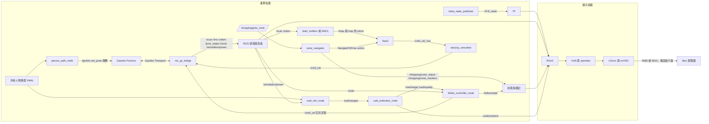
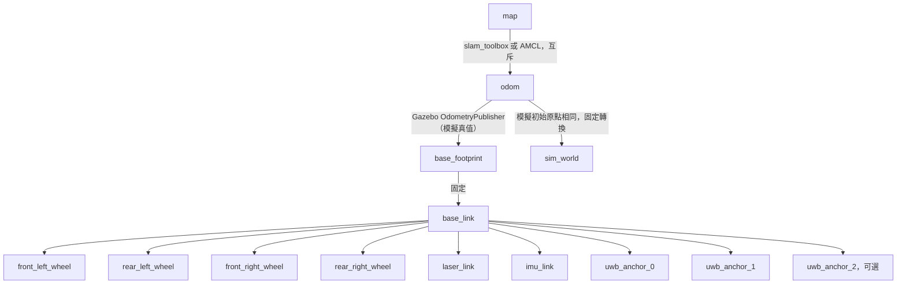

# 系統架構

運算容器處理 Gazebo Fortress、感測器橋接、TF、SLAM、Nav2、區域導航及 UWB 跟隨；顯示容器只執行 Xvfb、openbox、VNC／noVNC 與按需啟動的 RViz。兩者在相同橋接網路使用 Fast DDS UDPv4，相同領域編號；不依賴跨容器共享記憶體。

`map` 在純跟隨模式不存在，因此 RViz 預設使用 `odom`；導航改用 `map`。模擬原點為機器人初始平面位置 `(0, 0)`，朝向正 x。展示場景為 12 × 10 公尺的小型模擬商店，四排貨架中心 x = −3.6、−1.2、1.2、3.6，皆涵蓋 y = 1 至 5，寬 0.8 公尺。三條貨架間走道中心為 x = −2.4、0、2.4，淨寬皆為 1.6 公尺，大於 1.2 公尺需求；車寬 0.50 公尺與 0.55 公尺膨脹半徑可容納於走道。前後橫向通道位於 y = 0 與 5.9。南側 y = −3 留寬 2 公尺入口，結帳櫃臺位於 `(4.5, −1)`，導航目標在櫃臺西側 `(3, −1)`。

機器人明確以世界姿態 `(0, 0, 0.02)`、roll／pitch／yaw 皆為 0 出生；0.02 公尺為落地餘量。`odom` 初始平面原點與世界一致，`map` 使用此起點建圖；定位時也須載入相同座標的地圖與初始姿態。六個 `map` 區域目標位於三條走道與入口／結帳前的自由空間。純 Python 測試直接解析 SDF 的實際碰撞盒，檢查四排／三走道數量、寬度、出生點的 0.7 公尺淨空、雷射前方 ±30 度至 0.7 公尺的自由空間與每個目標的 0.55 公尺淨空，以及人物每個航點和整段循環路徑的 0.30 公尺淨空，避免另外維護一份失同步的配置。

## 套件與介面

| 套件 | 責任 |
| --- | --- |
| shopping_robot_description | 車體尺寸屬性、四輪關節、雷射、IMU 與錨點 TF |
| shopping_robot_gazebo | 世界、人物路徑、模擬啟動、單向橋接設定 |
| shopping_robot_slam | 非同步建圖、序列化位姿圖定位 |
| shopping_robot_navigation | Humble Nav2、Regulated Pure Pursuit、代價地圖、速度平滑、可選 AMCL |
| shopping_robot_bringup | 互斥使用的建圖／引導／跟隨入口與 RViz |
| shopping_zone_manager | 區域資料驗證、別名查詢、NavigateToPose 動作客戶端 |
| shopping_uwb_follow | 測距、平面估測、濾波、控制及人物位姿模擬節點 |

`/uwb/ranges` 是 Float32MultiArray，順序對應 `anchor_x/anchor_y`，單位公尺，NaN 表示掉包；無額外時間戳，僅限目前模擬。`/uwb/target` 為 base_link 下的 PointStamped，x 向前、y 向左；`/uwb/quality` 是 Float32，三錨點的基準值為 1、兩錨點為 0.5，再依測距殘差降低。這不是校準過的統計機率。

三錨點使用平方距離差線性解加上 Gauss–Newton 修正；兩錨點解兩圓交點，有前後歧義。啟動時選前半平面，之後選最接近前次估計的位置；錨點預設沿左右方向配置，任意旋轉配置不保證可單靠前半平面消除歧義。平滑濾波在資料過期或時間倒退後重設。控制節點使用目標時間戳偵測過期，50 毫秒更新；超過 0.5 秒沒有有效目標或雷射便停止。

`sim`／`mapping`／`guide` 預設 `person:=false`，人物初始停放店外 `(20, 20)` 且不啟動路徑節點；明確傳入 `person:=true` 才移入路徑。`follow` 固定啟用人物，路徑起點為 `(1.5, 0)`，首段沿 y = 0 的自由橫向通道向 +x 移動。人物圓柱透過 Fortress `set_pose` 服務每 0.1 秒更新，UWB 以同一份路徑與絕對模擬時間計算人物位置；Gazebo 顯示可能有一個更新週期的延遲。機器人位置取 SceneBroadcaster 的真實模型位姿（橋接至 `/simulation/poses`），不使用可能受滑移影響的輪式里程計作測距真值。`/uwb/person_ground_truth` 使用 `sim_world`。更換世界、模型名稱或初始機器人位置時須同步修改此對應與固定 TF。

`follow_metrics.py` 為不匯入 ROS 的評估模組：`FollowSample` 記錄時間、base_link 估測、odom 平面車體姿態與相同世界座標的真值；`sample_metrics` 將估測旋轉平移後計算歐氏誤差及真實跟隨距離。`evaluate_series` 對遞增時間序列產生按樣本加權的誤差平均／RMSE／最大值、距離平均／最小／最大值及樣本數與期間，空序列或非有限資料會拒絕。

`follow` 同時啟動 `uwb_eval_node`，使用最新 `/odom`、`/uwb/person_ground_truth` 及 `/uwb/target`，三筆時間戳最大差不超過 `max_skew`（預設 0.15 秒）才發布 `/uwb/estimate_error`（Float32，公尺）；缺資料、過期或座標框架不符時略過。依既有固定 TF，sim_world 與 odom 平面座標對齊；不插值、不補償里程計漂移，結果也包含取樣時間差、濾波延遲及漂移。人物真值仍為共用路徑的解析值，非圓柱服務實際到位的回報。

## 模擬設計決策

| 決策 | 原因 |
| --- | --- |
| `/odom` 與 `odom→base_footprint` 來自 OdometryPublisher（真值） | 滑移轉向的 DiffDrive 輪式里程計 yaw 漂移嚴重（實測短程後誤差超過 100 度）；輪式里程計改發布於 `/wheel_odom` 供比較，噪聲模型與 EKF 列入時程 |
| DiffDrive 等效輪距 = 幾何輪距 × `skid_track_factor`（2.0），車輪摩擦 0.5 | 四輪側向摩擦讓小角速度命令幾乎無法轉向；實車需重新校正此係數 |
| Regulated Pure Pursuit，先原地轉向再前進 | DWB 在 1.6 公尺走道切角卡住；RPP 對差速／滑移底盤較穩定 |
| 世界加入四個不對稱地標、slam_toolbox 縮小迴圈搜尋範圍 | 四排相同貨架間距 2.4 公尺，曾讓地圖整體跳一個走道 |
| 顯示容器共用運算容器網路命名空間 | Docker 橋接網路的 DDS 多播探索失敗 |
| `ROS_APT_MIRROR` 建置參數 | 部分網路無法連線 packages.ros.org |

## 安全邊界與後續整合

| 狀態 | 條件與輸出 |
| --- | --- |
| FOLLOWING | 有效目標與雷射；距離／方位比例控制，速度與加速度受限，預設不倒車 |
| TOO_CLOSE | 目標距離 ≤ 0.6 公尺，立即零 Twist |
| LOST | 目標遺失、無效或超過 0.5 秒，立即零 Twist |
| OBSTACLE_STOP | 前方障礙 ≤ 0.65 公尺，線速度立即歸零；有效且不過近的目標允許原地轉向，角速度 ≤ 1.0 rad/s、角加速度 ≤ 1.5 rad/s²；雷射失效時立即零 Twist |
| IDLE | 停用或控制時間間隔無效，立即零 Twist |

TOO_CLOSE、LOST 與停用優先於障礙轉向。前方扇區為正前方左右各 30 度；無有效前方讀值或無效掃描角度時回報不可用並停止，正無限遠讀值視為無命中，零距離及低於量測下限的非負讀值視為需立即停止前進。控制時間倒退或無效時也歸零；這是局部停止保護，尚無繞障路徑規劃。Nav2 使用雷射障礙層與膨脹層，速度平滑由官方 navigation_launch 接線。尚未啟用 collision_monitor。

未來的模式管理器應仲裁引導／跟隨／待機命令，加入獨立速度逾時看門狗，再整合障礙恢復。現階段啟動流程靠操作者互斥，不可同時發送不同模式的速度。所有硬體驅動將另行設計成明確選用，現階段沒有實作。

## 版本參考

Fortress 外掛與感測器依據 [Fortress 感測器文件](https://gazebosim.org/docs/fortress/sensors/)；Nav2 參數名稱以 [Humble 官方設定](https://github.com/ros-navigation/navigation2/blob/humble/nav2_bringup/params/nav2_params.yaml) 為準；橋接使用 [ros_gz Humble 設定格式](https://github.com/gazebosim/ros_gz/blob/humble/ros_gz_bridge/test/config/full.yaml)。SLAM 啟動方式另核對 [Humble 官方 launch](https://github.com/SteveMacenski/slam_toolbox/blob/humble/launch/online_async_launch.py)。這些參考不代表本骨架已完成容器整合測試。
