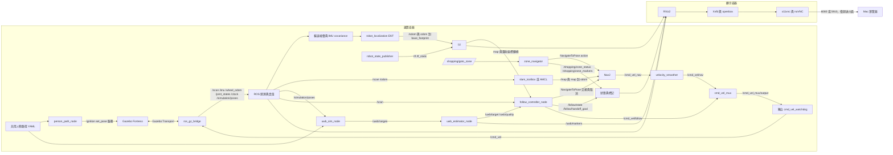
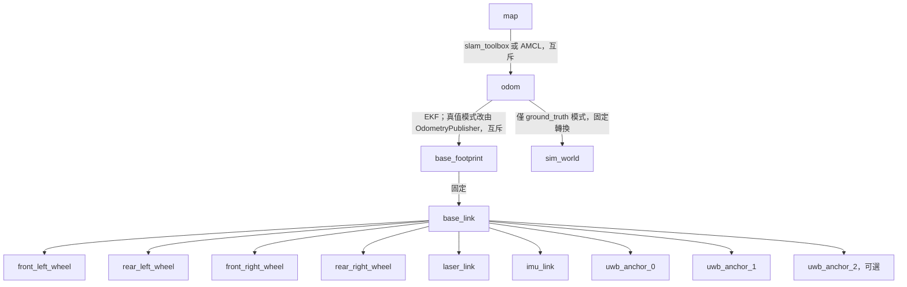
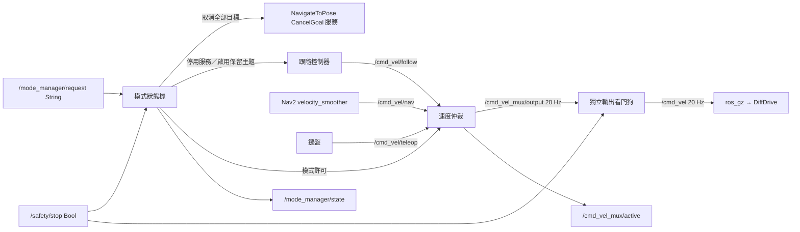

# 系統架構

運算容器處理 Gazebo Fortress、感測器橋接、TF、SLAM、Nav2、區域導航及 UWB 跟隨；顯示容器只執行 Xvfb、openbox、VNC／noVNC 與按需啟動的 RViz。兩者在相同橋接網路使用 Fast DDS UDPv4，相同領域編號；不依賴跨容器共享記憶體。

`sim`、`mapping`、`guide` 與 `follow` 都接受 `odom_source:=ekf|ground_truth`，預設 `ekf`，不支援執行途中切換。兩種模式都保留原始 `/wheel_odom` 與 `/sim/ground_truth_odom`；後者框架為 `sim_world → base_footprint_gt`。其 Gazebo TF 主題 `/sim/ground_truth_tf` 不橋接；DiffDrive 的 `wheel_tf` 也不橋接，避免同一車體有多個 TF 來源。

| 模式 | `/odom` 與 `odom → base_footprint` 唯一來源 | 世界座標關係 |
| --- | --- | --- |
| `ekf`（預設） | `robot_localization/ekf_node`，40 Hz、`two_d_mode: true`、`world_frame: odom` | 不發布 `odom → sim_world`；真值不接入估測 TF 樹 |
| `ground_truth` | 額外啟用舊 OdometryPublisher 與 `bridge_ground_truth.yaml` | 保留舊 `odom → sim_world` 單位轉換 |

用兩個橋接檔隔離真值模式專用的 `/odom`、`/tf`，並以相同 `odom_source` 條件控制 xacro 舊真值外掛與 launch 節點，避免 EKF 與模擬器同時發布車體 TF。真值模式有獨立的診斷真值外掛與舊輸出外掛，兩者使用相同模擬位姿。

EKF 設定安裝於 `shopping_robot_gazebo/config/ekf.yaml`，僅融合 `/wheel_odom_noisy` 的 vx、vyaw 與 `/imu/with_covariance` 的 vyaw；輪式位置是相同編碼器資料的積分，不重複融合。六軸 IMU 沒有磁力計或外部航向基準，因此排除模擬器提供的絕對 orientation，也不融合加速度；yaw 仍會隨陀螺儀偏差漂移。此選擇依 [robot_localization 感測器設定說明](https://github.com/cra-ros-pkg/robot_localization/blob/humble-devel/doc/configuring_robot_localization.rst)，參數順序依 [Humble EKF 範例](https://github.com/cra-ros-pkg/robot_localization/blob/humble-devel/params/ekf.yaml)。

IMU 三軸角速度使用標準差 0.005 rad/s、偏差平均幅度 0.0005 rad/s、偏差標準差 0.0001 rad/s；三軸加速度分別為 0.05 m/s²、0.01 m/s²、0.002 m/s²。偏差由 Gazebo 抽樣，正負號可能不同，並非指定固定正偏差；格式依 [SDFormat 感測器規格](https://sdformat.org/spec/1.6/sensor/)。`wheel_odom_noise` 使用 ROS-free `odom_noise.py`，預設種子 42、線速度比例 1.01、角速度比例 1.02、Gaussian 標準差 0.01 m/s 與 0.02 rad/s；這些都是同名節點參數。種子只控制此 Python 輪速噪聲序列，不控制 Gazebo IMU 或物理引擎。輪速融合 covariance 下限為 0.02² 與 0.10²，對滑移角速度保留較大不確定度，讓陀螺儀主導偏航速度。節點同時保留 `/imu` 的時間戳、框架與量測，輸出角速度 covariance 0.005²、加速度 covariance 0.05²，orientation covariance 首項為 −1，避免橋接器回傳零 covariance 或模擬絕對朝向被誤用。`/wheel_odom_noisy` 的 pose 保留原始輪式積分值，只有 twist 加噪，不能把該 pose 當成加噪速度的積分結果。

`odom_drift_monitor` 在兩種模式都啟動，將 `/sim/ground_truth_odom` 以相鄰時間戳線性插值到 `/odom` 時間（yaw 取最短角），最多跨 0.1 秒，不外插。資料過期 0.5 秒後不再發布；時間倒退會清空歷史。每 5 秒記錄並發布 `/sim/odom_drift`（Float32MultiArray），順序為平移誤差 m、絕對最短航向誤差 rad、累積真值路程 m、平移誤差 m/m、航向誤差 rad/m。路程為已配對樣本間真值平移距離總和，未移動時兩個每公尺指標為 NaN；純旋轉不能用每公尺指標評估。ROS-free `odom_metrics.py` 可直接處理時間對齊的 `Pose2`。目前比較共用出生原點的座標，不做事後最佳對齊；更改出生姿態、重啟 EKF 或中途啟動監測器時需自行處理原點與統計期間，不能把初始偏移當作漂移性能。

RViz 設定只顯示 `base_link` 下的 UWB 估測標記，沒有依賴 `sim_world` 的顯示項目，故不需更動。`/uwb/person_ground_truth` 仍可供程式評估或記錄；在 EKF 模式若要直接顯示世界真值，須另開以 `sim_world` 為固定框架的檢視，不應新增假的單位 TF。

`follow` 現在同時啟動 SLAM 與 Nav2，預設使用線上建圖，亦可透過 `slam_mode`／`map` 選擇定位。RViz 預設仍為 `odom`；需要顯示地圖與交接目標時改為 `map`。模擬原點為機器人初始平面位置 `(0, 0)`，朝向正 x。展示場景為 12 × 10 公尺的小型模擬商店，四排貨架中心 x = −3.6、−1.2、1.2、3.6，皆涵蓋 y = 1 至 5，寬 0.8 公尺。三條貨架間走道中心為 x = −2.4、0、2.4，淨寬皆為 1.6 公尺，大於 1.2 公尺需求；車寬 0.50 公尺與 0.55 公尺膨脹半徑可容納於走道。前後橫向通道位於 y = 0 與 5.9。南側 y = −3 留寬 2 公尺入口，結帳櫃臺位於 `(4.5, −1)`，導航目標在櫃臺西側 `(3, −1)`。

機器人明確以世界姿態 `(0, 0, 0.02)`、roll／pitch／yaw 皆為 0 出生；0.02 公尺為落地餘量。`odom` 初始平面原點與世界一致，`map` 使用此起點建圖；定位時也須載入相同座標的地圖與初始姿態。六個 `map` 區域目標位於三條走道與入口／結帳前的自由空間。純 Python 測試直接解析 SDF 的實際碰撞盒，檢查四排／三走道數量、寬度、出生點的 0.7 公尺淨空、雷射前方 ±30 度至 0.7 公尺的自由空間與每個目標的 0.55 公尺淨空，以及人物每個航點和整段循環路徑的 0.30 公尺淨空，避免另外維護一份失同步的配置。

## 套件與介面

| 套件 | 責任 |
| --- | --- |
| shopping_robot_description | 車體尺寸屬性、四輪關節、雷射、IMU 與錨點 TF |
| shopping_robot_gazebo | 世界、人物路徑、模擬啟動、單向橋接設定 |
| shopping_robot_slam | 非同步建圖、序列化位姿圖定位 |
| shopping_robot_navigation | Humble Nav2、Regulated Pure Pursuit、代價地圖、速度平滑、可選 AMCL |
| shopping_robot_bringup | 建圖／引導／跟隨入口、模式仲裁啟動與 RViz |
| shopping_zone_manager | 區域資料驗證、別名查詢、NavigateToPose 動作客戶端、離線評估報表、模式狀態機與獨立速度看門狗 |
| shopping_uwb_follow | 測距、平面估測、濾波、控制及人物位姿模擬節點 |

### 區域導航狀態與取消

`shopping_zone_manager/goal_tracker.py` 為不匯入 ROS 的狀態機；`node.py` 負責執行送出與取消效果。世代計數器將接受、結果、取消回覆綁定至同一個目標，舊世代事件不會覆寫目前狀態。流程為 `IDLE → PENDING → ACTIVE → SUCCEEDED／ABORTED`，拒絕目標為 `REJECTED`；取消經過 `CANCELING`，直到 action result 才回報 `CANCELED`。取消遭拒或通訊例外回報 `CANCEL_FAILED` 並保留忙碌狀態，不能視為已停止。

常駐節點統一處理 `/shopping/goto_zone`，`goto_zone` 不再自行送 action，因此共用預設 `BUSY` 政策。節點參數 `preempt` 預設為 `false`，啟用後只保留最新排隊要求，舊動作結束後才送新目標；取消失敗或接受回覆逾時會清除排隊要求。`UNKNOWN_ZONE` 與 `UNAVAILABLE` 不送 action，忙碌時的新要求不改變舊目標生命週期。`/shopping/zone_status` 使用 `CODE: text`，`ACTIVE` 的距離回饋限速約 1 Hz；`/shopping/cancel`（Empty）與 `/shopping/cancel_goal`（Trigger）共用非阻塞取消流程。

`response_timeout` 預設 5 秒，以單調時間判定；推進狀態的計時器使用穩定時鐘，即使模擬暫停仍能回報 `TIMEOUT`。目標姿態與標記時間戳仍使用一致的 `use_sim_time`。尚未接受時要求取消，收到 handle 後立即取消；逾時亦保留 future 與未結束標記，延遲接受的 handle 立即取消，直到舊請求確定結束才允許新目標。若 DDS 永遠不回覆，無法取得 handle，也無法證明已停止，因此保持忙碌，需維護者檢查 Nav2。遺失結果時同樣保留 handle 供後續取消，不自行假定成功。

`goto_zone --timeout`（預設 300 秒）保留 Nav2 伺服器 15 秒等待上限，並在 Ctrl-C／期限到達時要求取消、有限等待結果；`cancel_zone` 的服務成功只表示已處理要求。共用狀態主題沒有呼叫者識別碼，目前限定單一互動呼叫者。`nav_action_check` 在專用模擬操作時段使用同一 adapter 的獨立實例，不建立第二組指令／服務端點，以 map 座標 `(50, 50)` 作為不可達目標（`unreachable goal`），讀取安裝版 NavFn 容許值，確認與 SDF 牆面所圍商店外框及實際全域成本地圖外框的距離皆超過容許值加 1 公尺；再要求 `ABORTED`／`REJECTED`，保留單項逾時取消。以 `/odom` 確認取消後停止，預設輸出五項檢查表。`--tolerance-check` 增加正常區域抵達誤差檢查，成功結果後取得新鮮 `/odom`，預設誤差上限 0.35 公尺（`--max-final-error` 可調），表格列出誤差；直接比較 odom 與 map，限模擬原點對齊且漂移可忽略時使用，不補償 map→odom 修正。常駐管理器須保持閒置，且不得同時執行跟隨、鍵盤或其他 action client。其離線語法檢查與狀態機 pytest 不取代 Humble 容器建置及 Gazebo 驗收。

`/uwb/ranges` 是 Float32MultiArray，順序對應 `anchor_x/anchor_y`，單位公尺，NaN 表示掉包；無額外時間戳，僅限目前模擬。`/uwb/target` 為 base_link 下的 PointStamped，x 向前、y 向左；`/uwb/quality` 是 Float32，三錨點的基準值為 1、兩錨點為 0.5，再依測距殘差降低。這不是校準過的統計機率。

三錨點使用平方距離差線性解加上 Gauss–Newton 修正；兩錨點解兩圓交點，有前後歧義。啟動時選前半平面，之後選最接近前次估計的位置；錨點預設沿左右方向配置，任意旋轉配置不保證可單靠前半平面消除歧義。平滑濾波在資料過期或時間倒退後重設。控制節點使用目標時間戳偵測過期，50 毫秒更新；超過 0.5 秒沒有有效目標或雷射便停止。

`sim`／`mapping`／`guide` 預設 `person:=false`，人物初始停放店外 `(20, 20)` 且不啟動路徑節點；明確傳入 `person:=true` 才移入路徑。`follow` 固定啟用人物，路徑起點為 `(1.5, 0)`，首段沿 y = 0 的自由橫向通道向 +x 移動。人物圓柱透過 Fortress `set_pose` 服務每 0.1 秒更新，UWB 以同一份路徑與絕對模擬時間計算人物位置；Gazebo 顯示可能有一個更新週期的延遲。機器人位置取 SceneBroadcaster 的真實模型位姿（橋接至 `/simulation/poses`），不使用可能受滑移影響的輪式里程計作測距真值。`/uwb/person_ground_truth` 使用 `sim_world`。更換世界、模型名稱或初始機器人位置時須同步修改此對應與漂移評估的原點假設。

`follow_metrics.py` 為不匯入 ROS 的評估模組：`FollowSample` 記錄時間、base_link 估測、共用世界框架下的平面車體姿態與人物真值；`sample_metrics` 將估測旋轉平移後計算歐氏誤差及真實跟隨距離。`evaluate_series` 對遞增時間序列產生按樣本加權的誤差平均／RMSE／最大值、距離平均／最小／最大值及樣本數與期間，空序列或非有限資料會拒絕。

`follow` 同時啟動 `uwb_eval_node`，使用最新 `/sim/ground_truth_odom`、`/uwb/person_ground_truth` 及 `/uwb/target`，三筆時間戳最大差不超過 `max_skew`（預設 0.15 秒）才發布 `/uwb/estimate_error`（Float32，公尺）；缺資料、過期或座標框架不符時略過。車體與人物真值皆在 `sim_world`，直接用真值車體姿態轉換估測，不依賴 TF，也不包含 EKF 漂移；仍不插值，因此結果包含取樣時間差及濾波延遲。人物真值仍為共用路徑的解析值，非圓柱服務實際到位的回報。

## 跟隨與 Nav2 交接

`follow_handoff.py` 不匯入 ROS，負責視線幾何與 DIRECT／NAV2 狀態；控制節點保留原本直接跟隨狀態名稱，導航持有控制權時發布 `NAV2_HANDOFF: 原因`；視線經遲滯確認受阻、尚未交接時發布 `BLOCKED_WAIT` 並輸出零速；短暫受阻仍發布 `FOLLOWING` 並減速。跟隨 launch 固定啟用人物，同時載入 `navigation.launch.py`，不啟動 `zone_navigator`。全流程使用相同 `use_sim_time`；map→odom 仍由所選 SLAM／定位來源單獨發布。

有效且距離大於 `follow_distance + handoff_margin`（1.3 公尺）的目標，在 OBSTACLE_STOP 或遲滯確認視線遮擋後持續 `handoff_delay`（YAML 為 0.5 秒）才交接。LOS 檢查從雷射原點到人物的半寬 0.25 公尺走廊，至少包含最近方位射線；障礙距離小於人物距離減 `los_margin`（0.35 公尺，涵蓋人物半徑 0.25 公尺與估測餘量）才阻擋。正無限遠視為暢通，低於量測下限視為阻擋；空掃描、NaN、負值、超過有限上限或無效角度視為失效。節點以量測時間查詢 TF，將 base_link 目標轉到雷射框架，避免忽略雷射前移 0.18 公尺；map←base_link 不可用時不交接，導航中轉換失敗則取消。這些是平面轉換，適用目前地面模擬。

NavigateToPose 目標為人物本身的 map 座標，朝向由車體指向人物。人物相對上次送出目標移動超過 0.4 公尺，且已經過 0.5 秒才更新；直接送出新的 NavigateToPose，由 bt_navigator 搶占執行中的目標，不取消、不等待停止。節點以世代編號追蹤目前目標，忽略已取代目標的接受／拒絕回覆、結果、取消確認與傳輸例外；這些回呼不得更改目前目標控制代碼、導航狀態、失敗冷卻或第一筆直接命令。舊目標延遲收到接受回覆時也不補送取消，以免干擾目前導航。`/follow/handoff_goal` 發布實際送出的 map PoseStamped。為容納人物占據的格子，共用 NavFn `tolerance` 從 0.3 提高為 0.8 公尺，讓規劃器尋找附近自由終點；未偏移目標。引導模式也使用此容差，受阻區域目標可能在 0.8 公尺內的其他位置結束，必須核對實際終點，不能只看成功回報。動態人物與終點容差的實際互動仍待模擬驗收。

`LosDebouncer` 使用節點時鐘，原始 LOS 連續受阻 `los_block_time=0.3` 秒才鎖定受阻；鎖定後必須在半寬加上 `los_clear_extra_width=0.10` 公尺的走廊連續暢通 `los_clear_time=0.6` 秒才解除。暢通確認也適用於未鎖定受阻的短暫抖動，避免接近人物時以單筆清空資料切回。時間倒退或非有限時間重設，安全事件也清除 LOS 計時。原始受阻但尚未確認時，直接線速度乘上 `los_uncertain_speed_factor=0.6`，尚不進入 BLOCKED_WAIT；前方緊急停止不經此延遲。

側向減速放在不匯入 ROS 的 `follow_controller.py`：左右 30°～100°（`side_sector_min/max`，弧度）取最小橫向淨空，`side_slow_clearance=0.35` 公尺以下用 `side_min_speed_factor=0.4`，`side_free_clearance=0.75` 公尺以上用 1，中間線性插值；缺少側向讀值採最低倍率。此倍率與 LOS 倍率相乘，縮放線速度與上限，再套用原本加速度限制；角速度不因側向淨空額外放大。掃描失效仍立即停止。

導航進入後至少保持 `min_nav_hold=1.5` 秒，目標更新不重設保持起點。保持後，LOS 須遲滯確認暢通，並符合「人物距離不超過 1.3 公尺」或「前方淨空大於 0.8 公尺持續 `resume_delay=0.5` 秒」才取消並切回 DIRECT。近距離路徑略過額外 resume_delay，仍保留 LOS 確認與最短導航保持。導航成功可直接結束，目標遺失／過期、過近、停用、雷射失效立即取消並發布零 Twist；導航拒絕、失敗或非預期取消則切回直接控制，冷卻 3 秒後才重新累計受阻時間。恢復 DIRECT 後須保持 `min_direct_hold=1.0` 秒；若 LOS 已連續確認受阻同樣長的時間，可提前交接，但仍須符合 handoff_delay。`route_around:=false` 不建立 ActionClient 或 TF listener，保留直接跟隨與側向減速。

遲滯用穩定性換取恢復延遲：一般情況暢通確認再加 resume_delay 約需 1.1 秒，導航最短保持時間與此計時並行；近距離僅需 0.6 秒暢通確認，導航成功不等待。加寬走廊若仍擦到貨架，恢復可能更久。人物 map 目標與 NavFn 0.8 公尺容差保持原設定；取消排空時間也仍存在。直接速度 0.5 m/s 已等於 Nav2 平滑器上限且高於人物 0.35 m/s，不提高速度；比例追蹤即使沒有停車仍有約 0.5 公尺等速誤差。這些條件不保證距離一定縮短，需由下一輪 240 秒模擬比較切換率、停留時間、真實距離與停滯窗。

`follow_metrics.state_statistics` 接受嚴格遞增的 `(t, state)`，計算每分鐘切換次數與每狀態的停留統計，最後區間僅到最後觀測時間。`scripts/follow_state_stats.py` 解析 `/follow/state` 的 `data: STATE: 原因`，支援同行時間戳；無時間戳時依指定取樣週期估計，預設 20 Hz，拒絕混用時鐘。比較前後版本時應使用相同紀錄方式，僅記錄變更事件時務必附時間戳。

速度互斥以動作生命週期執行：NAV2 期間直接控制器不發布一般 `/cmd_vel/follow` 命令，由 Nav2 的 velocity_smoother 輸出；安全事件切回 DIRECT 後可立即發布零命令。取消回覆不代表已停止，須等終止結果；若仍在等待送出回覆，收到接受結果後補送取消。僅 NAV2→DIRECT 交接進入速度排空等待；確認目標終止後，若外部導航命令已安靜至少 0.3 秒，或最新外部命令符合 `|v| < 0.02 m/s` 且 `|w| < 0.05 rad/s`，便可恢復直接發布。終止確認後最多再等 2 秒，即使仍收到非零命令也恢復；此上限不允許略過目標終止確認。沒有收到命令時自交接開始計算安靜時間。節點以 `observed_cmd_vel_topic` 選擇觀察來源，仲裁模式設為 `/cmd_vel/nav`，可直接接收 Nav2 的零速；舊接線預設 `/cmd_vel`，Humble 回呼只有訊息，故以自身發布後 0.2 秒內的零命令近似排除自身訊息，沒有使用 GID 或新版回呼 API。排空判斷放在不匯入 ROS 的 `VelocityDrain`，安全事件在排空中仍立即發布零速。第一筆直接命令為零，控制器內部速度也歸零；目標更新不啟動此等待。傳輸例外而無法確定遠端是否仍執行時，保留控制權並記錄錯誤，禁止自行恢復直接移動；需操作者停止該流程並檢查動作服務。外層速度仲裁見下節；follow 執行時仍不得另送導航目標。只啟動一個 bringup，以模式請求切換鍵盤／引導／跟隨。

SDF 貨架止於 y=5.0，因此車體 `(2.4, 5.0)` 朝 +y、人物 `(1.0, 5.9)` 時走廊已清空；幾何測試直接讀取貨架碰撞盒，以接近末端的 `(2.4, 4.5)` 驗證走廊遮擋，並保留 y=5.0 的清空對照，未修改場景幾何。

`shopping_zone_manager/eval_metrics.py` 補充純 Python 導航回合、旋轉足跡間距、跟隨距離／狀態及停止延遲評估；`eval_report` 從 CSV／JSONL 產生 JSON 與 Markdown，直接解析既有 SDF 碰撞盒，不匯入 ROS。指標定義、輸入欄位、主題對應與建議驗收門檻見 [模擬評估指標](METRICS.md)。錄製與 rosbag 轉換仍屬後續工作。

## 模式管理與速度仲裁

純邏輯位於 `shopping_zone_manager/mode_control.py`，不匯入 ROS；維持七個套件。`ModeManager` 發出取消導航、停用／啟用跟隨等效果，`VelocityMux` 負責來源優先序、模式許可、逾時、有限值檢查與限速，`VelocityLimiter` 限制一般加速度。`cmd_vel_mux` 程序整合模式管理與仲裁，`cmd_vel_watchdog` 為另一個程序，僅由它發布 `/cmd_vel`，原本橋接與 Fortress DiffDrive 不變。

| 模式 | 許可來源與行為 |
| --- | --- |
| IDLE | 持續零速；所有新移動都需明確模式請求 |
| GUIDE | nav |
| FOLLOW | follow 優先，nav 次之，保留跟隨交接 Nav2 的流程 |
| TELEOP | teleop |
| ESTOP | 鎖定零速，只有 reset 可返回 IDLE；false 急停訊息不解除 |

每次有效模式請求立即發布零速、清除來源快取，經至少一次零速更新後才可能啟用新模式。離開 GUIDE／FOLLOW 必須取消全部 NavigateToPose 目標；進入這兩個模式也先取消舊目標，以保護重啟情境。先以 `/follow/enable`（SetBool）停用跟隨，再透過 `/navigate_to_pose/_action/cancel_goal` 的 `action_msgs/srv/CancelGoal` 送出零 UUID、零時間戳。Humble ActionClient 沒有 cancel-all API，未使用新版 API。跟隨的停用服務立即停用並歸零，但有未接受／執行中的目標時回傳 `success=false` 並說明仍在等待終止，管理器會重試；收到延遲接受回覆時仍補送取消。需等停用服務成功、取消服務成功、回覆中被取消的各目標均收到相符終止狀態、動作狀態沒有 ACCEPTED／EXECUTING／CANCELING，且 nav 非零命令已安靜 0.55 秒才啟用新模式。服務未就緒、回覆失敗或無法確認目標終止時保持 IDLE 零速，不以逾時強行放行。快速切換及 reset 不會清除尚未完成的取消責任；舊世代回覆不得解除新請求的停止條件。從待機啟動 TELEOP 不需 Nav2 服務。

跟隨啟用使用 `/follow/enabled`（Bool，可靠且保留最新值），停用同時發布 false 並確認服務，避免啟動順序遺漏；原 `/follow/enable` 服務保留。在仲裁接線中，已停用且沒有未結束目標的跟隨節點不持續發布零命令，避免掩蓋導航。新模式啟用前收到的速度全部丟棄，必須等來源重新發布。一般模式下不要自行呼叫跟隨啟用服務繞過管理器。

| 介面／參數 | 預設與用途 |
| --- | --- |
| `/mode_manager/request` | String：idle、guide、follow、teleop、estop、reset |
| `/mode_manager/state` | String：大寫狀態，可靠且保留最新值；切換等待期間為 IDLE |
| `/cmd_vel_mux/active` | String：nav、follow、teleop、none、idle、estop；無效輸入加上 `:invalid` |
| `/safety/stop` | Bool：true 立即急停並鎖定；false 不解除 |
| `nav_timeout`／`follow_timeout`／`teleop_timeout` | 0.5／0.3／0.5 秒，以單調接收時間判定 |
| `safety_stop_timeout` | 0.5 秒；純邏輯保留安全零速來源，ROS 急停另走鎖定狀態 |
| `safety_stop_priority`／`teleop_priority`／`follow_priority`／`nav_priority` | 100／30／20／10；先套模式許可再排序 |
| `max_linear`／`max_angular` | 0.6 m/s／1.2 rad/s，非有限輸入整筆視為零並標記；非平面分量也拒絕 |
| `linear_acceleration`／`angular_acceleration` | 0.6 m/s²／1.2 rad/s²；零速及零分量不經減速斜坡，預設不倒車 |
| 看門狗 `timeout` | 0.25 秒，預設每 0.05 秒檢查並持續發布零速 |
| `initial_mode` | 節點及獨立 mode_mux launch 為 idle；guide／follow launch 分別為 guide／follow |
| `manage_follow` | 節點預設 false；follow launch 設 true，要求跟隨停用確認 |
| `use_mux` | guide／follow／navigation 預設 true；false 恢復原始直接速度接線 |
| 跟隨 `observed_cmd_vel_topic` | 單獨執行為 /cmd_vel；仲裁接線為 /cmd_vel/nav |

`use_mux:=true` 時，Nav2 velocity_smoother 的 `cmd_vel_smoothed` 與 behavior_server（spin／backup／drive_on_heading／assisted_teleop 恢復行為原本直接發布 `cmd_vel`）都以節點範圍重新映射導向 `/cmd_vel/nav`，controller_server 內部的 `cmd_vel_nav` 不變；因此 `/cmd_vel` 只有輸出看門狗一個發布者。

仲裁器與看門狗的 timer 使用 STEADY_TIME，接收逾時採 `time.monotonic()`；所有 ROS 節點仍傳入相同 `use_sim_time`，感測器與 TF 保持模擬時間。來源逾時後下一個 50 毫秒更新歸零，輸出看門狗則在最後一筆仲裁命令後 0.25 秒逾時，再加最多一個 50 毫秒更新及傳輸排程延遲。純邏輯的 `VelocityMux.output()` 支援零速只送一次（`zero_period=None`）或低頻重送；ROS 預設持續 20 Hz 送零，作為獨立看門狗的存活訊號。看門狗直接監聽急停與 reset，即使仲裁器卡住也會鎖定急停。

重啟後 `ModeManager` 與單獨啟動的仲裁節點一律從 IDLE 開始，沒有持久化移動狀態。guide／follow 的 `initial_mode` 為操作便利性明確例外，重新啟動相同 launch／保留相同參數會重新請求移動；驗收重啟安全時用 `initial_mode:=idle`，再以 `dev.sh mode MODE` 啟用。launch 不自動 respawn。只可有一個仲裁器與一個看門狗；若看門狗本身或橋接／模擬器也失效，本軟體鏈不能保證停止，未宣稱 Fortress 內建有已設定的命令逾時。`use_mux:=false` 沒有這層保護，須保持舊流程互斥。mapping 不啟動 Nav2，維持原本接線；需要保護時另外啟動 mode_mux 並把鍵盤改送 teleop 專用輸入。

容器驗收由維護者執行：建置及 colcon test 後，分別以 guide／follow 確認 `/cmd_vel` 只有看門狗一個發布者、Nav2 平滑器只輸出 `/cmd_vel/nav`、DIRECT 與 NAV2_HANDOFF 都可行走；切 idle／teleop 時確認舊目標終止、跟隨停用且先有零命令。測試停止各來源、暫停仲裁程序、急停／reset、保留看門狗重啟仲裁節點，以及 `initial_mode:=idle`；量測各層逾時。再以 `use_mux:=false` 驗證舊接線與跟隨排空仍可用。這些尚未在本次工作執行，無 ROS 測試與靜態檢查不代表容器驗收。

## 模擬設計決策

| 決策 | 原因 |
| --- | --- |
| 預設 EKF 融合輪速與陀螺儀，真值模式明確選用 | 滑移轉向的輪式 yaw 誤差大，以較低 gyro covariance 降低其影響；保留真值供比較，實際漂移數據仍待容器量測 |
| DiffDrive 等效輪距 = 幾何輪距 × `skid_track_factor`（2.0），車輪摩擦 0.5 | 四輪側向摩擦讓小角速度命令幾乎無法轉向；實車需重新校正此係數 |
| Regulated Pure Pursuit，先原地轉向再前進 | DWB 在 1.6 公尺走道切角卡住；RPP 對差速／滑移底盤較穩定 |
| 世界加入四個不對稱地標、slam_toolbox 縮小迴圈搜尋範圍 | 四排相同貨架間距 2.4 公尺，曾讓地圖整體跳一個走道 |
| 顯示容器共用運算容器網路命名空間 | Docker 橋接網路的 DDS 多播探索失敗 |
| `ROS_APT_MIRROR` 建置參數 | 部分網路無法連線 packages.ros.org |

## 安全邊界與後續整合

| 狀態 | 條件與輸出 |
| --- | --- |
| FOLLOWING | 有效目標與雷射；距離／方位比例控制，速度與加速度受限，預設不倒車 |
| TOO_CLOSE | 目標距離 ≤ 0.6 公尺，立即零 Twist |
| LOST | 目標遺失、無效或超過 0.5 秒，立即零 Twist |
| OBSTACLE_STOP | 前方障礙 ≤ 0.65 公尺，線速度立即歸零；有效且不過近的目標允許原地轉向，角速度 ≤ 1.0 rad/s、角加速度 ≤ 1.5 rad/s²；雷射失效時立即零 Twist |
| IDLE | 停用或控制時間間隔無效，立即零 Twist |

TOO_CLOSE、LOST 與停用優先於障礙轉向。前方扇區為正前方左右各 30 度；無有效前方讀值或無效掃描角度時回報不可用並停止，正無限遠讀值視為無命中，零距離及低於量測下限的非負讀值視為需立即停止前進。控制時間倒退或無效時也歸零；直接控制仍是局部停止保護；啟用交接後由 Nav2 規劃繞行。Nav2 使用雷射障礙層與膨脹層，速度平滑由官方 navigation_launch 接線。尚未啟用 collision_monitor。

預設引導／跟隨已加入模式管理與獨立速度逾時看門狗；繞過仲裁的舊接線及單獨建圖流程仍需操作者保持速度來源互斥。障礙恢復與容器整合驗收仍需後續確認。所有硬體驅動將另行設計成明確選用，現階段沒有實作。

## 版本參考

Fortress 外掛與感測器依據 [Fortress 感測器文件](https://gazebosim.org/docs/fortress/sensors/)；Nav2 參數名稱以 [Humble 官方設定](https://github.com/ros-navigation/navigation2/blob/humble/nav2_bringup/params/nav2_params.yaml) 為準；橋接使用 [ros_gz Humble 設定格式](https://github.com/gazebosim/ros_gz/blob/humble/ros_gz_bridge/test/config/full.yaml)。SLAM 啟動方式另核對 [Humble 官方 launch](https://github.com/SteveMacenski/slam_toolbox/blob/humble/launch/online_async_launch.py)。這些參考不代表本骨架已完成容器整合測試。

## 模擬故障注入與驗收

`shopping_robot_gazebo` 透過 ament_cmake_python 安裝 `shopping_robot_sim`，內含 ROS-free `faults.py`、`fault_check.py` 及 ROS 入口 `fault_injector`。所有入口僅由既有模擬 launch 明確選用，沒有硬體驅動或裝置連線。`fault_injection:=false` 預設不啟動中繼，不改既有資料路徑。sim／mapping／guide／follow 均轉傳此參數與 `fault_schedule`；UWB 來源僅由 follow 啟動。

啟用後的資料流：

- `sensor_bridge` 的 ROS `/scan` 改送 `/sim/raw/scan`，中繼輸出 `/scan`，供跟隨、SLAM 與 Nav2 共用。
- EKF 的 `odometry/filtered` 或 ground_truth 專用橋接的 `/odom` 改送 `/sim/raw/odom`，中繼輸出 `/odom`。僅凍結里程計訊息，不改 TF；TF 唯一發布者仍為原本的 EKF 或 Gazebo。這不是定位完全失效的模擬。
- `uwb_sim_node` 的 ranges 改送 `/sim/raw/uwb/ranges`，中繼至估測器；估測器的 target 改送 `/sim/raw/uwb/target`，中繼至跟隨。人物與車體真值完全獨立。

`/sim/fault` 接受 std_msgs/String。錯誤命令記錄警告而不更動故障；`/sim/fault_status` 使用 reliable、transient_local、depth 1，內容為排序後的故障名稱 JSON 陣列。`clear` 立即清除所有目前故障及凍結快取，但不取消尚未觸發的排程。同名故障重新注入取代原本到期時間；不同故障可疊加，drop 優先於 freeze。清除後等待下一筆原始資料恢復，不重播過期快取。

`fault_schedule` 為 YAML 字串清單，每列必須有非負有限的 `time`（相對模擬秒）、`fault` 及 `duration`。duration 為零表示持續；dropout 的零 duration 則使用命令所附秒數。排程依 time 穩定排序，模擬時間倒退會清除目前故障並重新計時、重播排程。噪聲預設種子 42，僅固定中繼的高斯亂數序列；不是整個物理模擬的重現保證。

| 故障 | 注入行為 | 跟隨預期安全反應 |
| --- | --- | --- |
| `uwb_stale` | 持續重播第一筆目標及其舊時間戳 | 超過原有 lost_timeout（預設 0.5 秒）進入 LOST，零 Twist；導航中取消目標 |
| `uwb_dropout:3.0` | 停送原始測距 3 秒，估測器不再產生新目標 | 與 stale 相同；恢復測距後重新估測 |
| `uwb_noise:0.5` | 每筆有限測距加入獨立 Gaussian 噪聲，負值截為零、NaN 保留 | 無法保證識別所有錯誤目標；維持速度上限、過近／遺失與雷射保護，不要求每次停車；兩錨點歧義與 NLOS 限制仍在 |
| `lidar_drop` | 停送掃描 | 量測超過 0.5 秒後 OBSTACLE_STOP、完整零 Twist，導航中取消；不得持續前進 |
| `lidar_freeze` | 重播掃描與舊時間戳 | 同 drop；不能因持續收到封包而誤認為新掃描 |
| `odom_freeze` | 重播里程計與舊時間戳，TF 繼續更新 | 故障模式的 follow 啟用 monitor_odom；超過 0.5 秒或尚無里程計時走掃描失效的安全停止路徑，零 Twist 並取消導航 |

UWB timeout 與 scan timeout 已使用來源時間戳，這次沿用原有參數；新增 `monitor_odom` 預設 false，只有故障模式 follow 自動啟用，以固定 0.5 秒里程計新鮮度門檻檢查。它共用 OBSTACLE_STOP／取消路徑，狀態不區分里程計與雷射失效；不是全域模式仲裁器或獨立命令看門狗。Nav2 非同步取消期間仍可能覆寫零命令，故驗收工具必須量測實際命令及真值，不能僅憑狀態宣告停車。

`scripts/fault_check.py`／`dev.sh fault-check` 對同一個已啟動的 follow 模擬，依序注入六種故障，每次保留 4 秒模擬時間並 clear。開始前必須收到 `/clock`、fault_status 且無活動故障；不可同時執行排程或另一個注入者。每次均要求注入前命令與真值有移動，清除後兩者均恢復移動；找不到移動基準或自然路徑暫停太久會 FAIL，不能用原本停著的車體冒充成功。預設等待移動／恢復最多 90 秒牆鐘，可設 `--motion-timeout`；每次故障保持階段另有 60 秒牆鐘上限，模擬暫停也會失敗。

| 驗收項目 | 提案門檻 |
| --- | --- |
| 命令停止 | 注入送出起 0.8 秒模擬時間內，`abs(vx) <= 0.02 m/s` 且 `abs(wz) <= 0.05 rad/s` |
| 真值停止 | 注入送出起 1.5 秒內，同上速度門檻；使用未注入的 `/sim/ground_truth_odom` |
| 持續停止 | 停止後直到 clear 前均維持門檻，至少 0.3 秒；晚到的非零命令會使停止延遲重新計算 |
| 資料覆蓋 | 故障期間兩個資料流的起端、尾端及中間缺口均不超過 0.25 秒；缺資料不能當零速 |
| 噪聲情境 | 不要求停車，量測命令／真值並檢查資料覆蓋；命令 abs(vx) <= 0.51 m/s、abs(wz) <= 1.01 rad/s（預設上限加數值餘量）與清除後恢復 |

工具以 `/clock` 對齊的本機接收時間計算延遲，同一模擬 tick 若收到多筆速度，保留非零命令以免掩蓋衝突；不是精確傳輸延遲量測。測試適用預設控制速度與逾時參數，改參數須同步審查門檻。每輪應分別以 `route_around:=false` 和 `true` 執行，並在導航交接時手動重測；自動腳本不保證注入時正處於 NAV2_HANDOFF，也不控制人物相位或路線，無法替代具固定情境的整合測試。目前測試僅驗證純邏輯與假回呼，尚未執行 ROS／Gazebo 故障驗收。

## rosbag 離線評估資料流

`dev.sh record` 透過 `scripts/record_bag.py` 載入區域管理套件的 `config/record_topics.yaml`，以 Humble sqlite3 和模擬接收時間保存至主機共用的 `bags/`。不錄雷射與 TF，使用獨立 `sim_world` 真值及既有區域狀態還原指標。`bag_to_eval.py` 是讀取 ROS 訊息的薄層；`bag_converter.py` 以純 Python 進行有界時間同步、區域回合還原與保護狀態事件轉換，再交給既有 `eval_report`。`eval-bag` 產生觀測 JSONL、轉換中繼資料與 JSON／Markdown 報告；固定場景採 map→世界零位移與零旋轉，其他對齊須明確提供。完整來源、缺資料與回放隔離規則見 [評估指標](METRICS.md#rosbag-記錄轉換與可重現流程)。這是旁路資料處理，不新增命令來源或改動 TF 所有權。

## 人物同步與跟隨量測

`shopping_uwb_follow.evaluation_metrics` 是不匯入 ROS 的純 Python 指標層；`evaluation_node` 提供 `person_sync_check` 與 `follow_eval` 兩個唯讀命令入口，訂閱回呼採 Humble 的單一 msg 引數。工具預設強制模擬時鐘，記錄一個有限時間窗，檢查來源時間、框架、0.25 秒資料覆蓋缺口，輸出表格、JSON 與結束碼。控制器、速度命令和調參維持原樣；ROADMAP 不自動勾選。

人物路徑仍只來自 Gazebo 套件的 `config/person_path.yaml`。世界 SceneBroadcaster 的 `/simulation/poses` 保留給既有 UWB 模擬；其 Pose_V 外層時間不會經 Humble TFMessage 轉換保留，因此人物模型額外載入 Fortress 唯讀 PosePublisher，發布各筆帶時間／父子框架的 Pose_V。follow launch 專用 `bridge_person.yaml` 將 `/model/person/pose` 單向接至 `/simulation/person_pose`，沒有接入 `/tf`。預期 `supermarket → person` 的平面位置與人物真值 `sim_world` 使用同一世界原點，不能用估測 `odom` 取代。未變更真值、EKF 或車體 TF 的發布權限。

同步檢查同時比較幾何、UWB 真值與解析路徑；預設平均偏差 <0.05 m、延遲絕對值 <0.1 s。跟隨評估從車體真值姿態轉換人物真實相對位置，搜尋 ±0.5 秒、0.01 秒格距的最佳位移；只對各候選皆可插值的共同樣本計算，不跨大缺口或外插。另按解析路徑航向率分直線／轉彎、統計真實距離與估測誤差，按 YAML 停止距離檢查近停後 0.5 秒內是否達到 ≤0.03 m/s 與 ≤0.05 rad/s 並持續停止，以及 UWB stale／LOST 後新鮮估測至 FOLLOWING 的時間（≤2 秒）。濾波延遲門檻為絕對值 <0.3 秒，分段距離偏差 RMSE <1.5 m。

狀態訊息沒有 header，以接收時模擬時間記錄；其排程誤差會影響恢復時間。延遲估計也包含取樣、橋接及位置偏差影響，不是內部函式耗時。缺少運動或搜尋結果貼邊不允許通過延遲檢查；缺少近停、轉彎、恢復情境或紀錄邊界截斷時標記 `NOT_COVERED`，不能當成完成驗收。近停與距離統計獨立於估測是否存在；缺包不會刪掉安全事件。使用者須先驗證同步，再安排缺口及近停情境。完整命令、門檻覆寫、結束碼和來源實作連結見 README 的「人物同步與跟隨評估」。
## MCU 通訊層（選用，2026-10-24）

`shopping_mcu_bridge/config/interface.yaml` 是標準訊息介面的唯一來源；`sim_mcu_firmware` 直接使用 DDS 模擬 MCU，`serial_bridge` 預設用程序內 PTY 與相同安全模型交換 CRC16 二進位訊框。兩者只訂閱 watchdog 輸出的 `/cmd_vel`，不新增速度發布者，輪速／encoder／IMU／狀態都隔離於 `/mcu/*`，不接入現有 EKF 或 TF。輪模型由 description xacro 取得輪徑與有效輪距；沒有新增馬達、裝置或板卡驅動。

`mcu_link_monitor` 發布 `/pc/heartbeat`，檢查 MCU heartbeat／status／急停；選用 `estop_on_link_loss` 時向既有 `/mode_manager/request` 請求 estop。安全期限使用單調壁鐘，訊息 stamp 使用 ROS 時鐘。失聯恢復需要三筆新 heartbeat，MCU latch 與 PC 模式急停均須明確重設。純邏輯、codec、transport 與 ROS 節點分開測試。

`comm.launch.py` 選 `sim_ros` 或 `serial_loopback`；follow／guide 以預設 false 的 `mcu_comm` 引入並沿用 `use_sim_time`。獨立 `dev.sh comm-sim` 才啟動額外 mux／watchdog。compose `comm` profile 的 agent 預設 UDP4:8888、無裝置映射，僅供未來真正 XRCE client；目前兩種模擬均不經 agent。未來硬體 EKF 接法、serial 的雙重啟用條件與驗收限制見 [MCU_INTERFACE.md](MCU_INTERFACE.md) 與 [MICROROS_GUIDE.md](MICROROS_GUIDE.md)。
