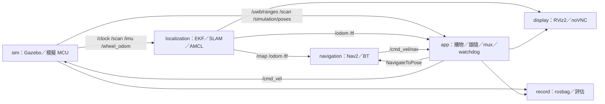

# 角色容器與 Compose profiles

預設仍是 `compute`＋`display` 的單一運算容器模式；原有 `up`、`guide`、`follow`、`nav2-build`、通訊端對端檢查及其他 `dev.sh` 指令保留。`split` 將同一套 launch 拆成角色容器，不增加 ROS namespace、不改主題名稱。所有流程僅供模擬，沒有裝置掛載、privileged、主機網路或固定架構。

| 角色／服務 | Profile | 工作內容 |
| --- | --- | --- |
| `compute` | 預設 | 閒置的共用網路命名空間與工具入口；拆分模式不啟動機器人節點 |
| `sim` | `split` | Fortress、模型、robot_state_publisher、感測器與時鐘橋接、輪速噪聲、人物路徑、模擬 UWB、模擬 MCU 與連線監測 |
| `localization` | `split` | EKF、里程計漂移監測；slam_toolbox 建圖／定位，或 map_server＋AMCL |
| `navigation` | `split` | Nav2、速度平滑器、行為樹；沿用 `nav2_stack:=apt|auto|fork` |
| `app` | `split` | 引導購物區域節點，或 UWB 估測／跟隨／評估；模式管理與 mux、唯一 `/cmd_vel` 發布者 watchdog |
| `display` | 預設；拆分時共用 | Xvfb、openbox、noVNC；RViz2 按需啟動 |
| `microros_agent`、`microros_client` | `comm` | 保留原服務名稱；UDP agent 與 Linux XRCE 模擬客戶端，預設不啟動 |
| `record` | `record` | 共用運算映像的 rosbag／評估工具入口，預設不錄製 |



`sim`、`localization`、`navigation`、`app`、`record` 透過 YAML anchor 使用同一個 `Dockerfile.compute` 映像及工作區安裝卷，僅啟動命令不同。建置工作區只需執行一次；堆疊運作時不要同時執行 colcon 或重建 Nav2 underlay。拆分不是硬體模式；未來替換 `sim` 為硬體服務仍須另外設計明確選用程序。

## 網路、時間與啟動順序

所有服務共用 `network_mode: service:compute`，只有 `compute` 加入 Compose bridge 並發布本機 6080／5910。這沿用既有 display 的方式，Docker Desktop（Mac arm64）與 Linux 都不需要 host networking，也不依賴橋接網路跨命名空間的 multicast。此設定仍使用本機命名空間內的 DDS discovery，並非 Fast DDS 靜態 unicast peer 設定。共用網路不代表共用 `/dev/shm`，因此所有 DDS 參與者沿用 `/etc/fastdds_udp.xml` 的 UDPv4-only transport、相同 `ROS_DOMAIN_ID`（預設 28）與 `rmw_fastrtps_cpp`。XRCE 客戶端使用 `rmw_microxrcedds`，由 agent 負責 DDS；兩者以 `127.0.0.1:8888` 連線，不發布主機 UDP port。

Gazebo transport 也使用相同網路命名空間，person_path_node、橋接與 GUI 可發現同一個 Fortress 世界。`sim` 是唯一 `/clock` 來源；四個角色 launch 固定傳入 `use_sim_time=true`，`record_bag.py` 使用 `--use-sim-time`，RViz 沿用既有模擬時間設定。`odom_source` 必須整組一致：預設 `ekf` 只由 localization 的 EKF 發布 `odom → base_footprint`；`ground_truth` 改由 sim 的 Gazebo OdometryPublisher 經橋接發布。輪式里程計 TF 不橋接。`map → odom` 僅由所選 slam_toolbox 或 AMCL 發布。

Compose 先等待 `compute` 健康，再啟動 `sim`。`sim` 健康檢查以有逾時的 `ign topic -l` 確認 `/world/supermarket/clock` 已公布，不建立 ROS participant、不呼叫 `ros2 topic`；其後才啟動 localization、navigation、app。這只驗證 Gazebo transport 可見，不能當作雷射、機器人生成、ROS `/clock`、TF 或 Nav2 已就緒的證明。navigation 等 localization 程序啟動；app 等 navigation 程序啟動，沒有假設 Nav2 lifecycle 已完成。既有模式管理器以 steady timer 重試取消服務，在服務晚到時持續輸出零；區域節點對未就緒的 action 拒絕目標，可於就緒後重送。

## Mac 與 Linux 操作

在 repo 根目錄執行；Bash 與 fish 均可直接呼叫腳本。先完成 Docker Desktop／Docker Engine 設定，主機不需要安裝 ROS。以下是維護者應依序執行的完整基本驗收命令：

```bash
./scripts/dev.sh build compute display
./scripts/dev.sh colcon-build
./scripts/dev.sh colcon-test
./scripts/dev.sh split-up guide headless:=true
./scripts/dev.sh split-status
./scripts/dev.sh nav-check --case-timeout 180
./scripts/dev.sh split-down
```

`nav-check` 仍在閒置的 compute 執行工具節點，但透過同一個 DDS 網路檢查拆分後的 Nav2 堆疊，會送出及取消模擬導航目標；驗收時保持獨占導航工作階段。若需確認發布者，在堆疊啟動期間執行：

```bash
docker compose -f docker/docker-compose.yaml --profile split exec app /usr/local/bin/compute-entrypoint ros2 topic info /cmd_vel --verbose
```

預期僅有 `cmd_vel_watchdog` 一個 publisher。需要圖形時，另開終端機執行 `./scripts/dev.sh rviz`，開啟 <http://localhost:6080/vnc.html>。`split-up` 不自動啟動 RViz。

Mac arm64 CPU 資源較有限，平常邏輯／套件測試與開發優先使用預設 `up` 的單運算容器模式；驗證容器邊界時使用 `split`＋`headless:=true`，先不要開 RViz、`comm` 或 `record`。拆分不會減少 Gazebo 與 Nav2 的計算量，反而增加容器程序。Linux 使用相同指令，不需要另外設定 `--platform` 或 `--network host`。

切換跟隨或定位模式：

```bash
./scripts/dev.sh split-up follow headless:=true
./scripts/dev.sh split-logs app
./scripts/dev.sh split-down
./scripts/dev.sh split-up guide headless:=true slam_mode:=map_server map:=/ws/src/shopping_robot_navigation/maps/supermarket.yaml
./scripts/dev.sh split-down
```

`split-logs` 持續跟隨單一服務日誌，以 Ctrl-C 結束日誌檢視。`split-status` 顯示所有 profiles 的容器。`split-up` 會先停止並移除同一 Compose 專案的既有服務，再重建角色堆疊，避免殘留的單容器 launch 與第二個 watchdog；具名建置卷及 bag 檔保留。它也會停止先前的 comm／record 工作，錄製中須先正常結束錄製。`split-down` 停止整個專案與選用 profiles。不要在拆分堆疊運作時執行單容器 `guide`、`follow`、`sim`、`mapping`、`comm-sim` 或 `comm-e2e-up`；回到原模式先 `split-down` 再 `up`。

共用參數逐項傳入所有角色，支援 `headless`、`odom_source`、`nav2_stack`、`slam_mode`、`map`、`person`、`route_around`、`fault_injection`、`fault_schedule`、`mcu_transport`；空白路徑與 JSON 排程須在主機 shell 用引號保護。腳本以逐行參數傳遞，不使用 eval，拒絕換行及未列出的參數；拆分不能透過參數關閉 mux 或改用壁鐘。單容器既有參數不受此介面限制。

私有 Nav2 underlay 仍由 `./scripts/dev.sh nav2-build` 建置於 `/nav2_ws`，所有角色共用相同安裝卷；完成後用 `split-up guide headless:=true nav2_stack:=fork`。`apt` 的隔離重新啟動會保留角色開關，不會意外重啟定位或第二套 Nav2；`auto` 延用既有偵測與回退規則。

## 選用 comm 與 record

通訊端對端驗收保留原本的獨立壁鐘流程，不需 Gazebo：

```bash
./scripts/dev.sh split-down
./scripts/dev.sh up
./scripts/dev.sh comm-e2e-up
```

另開終端機執行 `./scripts/dev.sh comm-e2e-check`；完成後停止前景 launch，再 `./scripts/dev.sh comm-down`。XRCE C 客戶端的 wheel telemetry 仍使用壁鐘時間戳，不能拿來替代 Gazebo 的 EKF 輸入或宣稱模擬時間驗收通過。完整流程見 [micro-ROS 指南](../hardware/MICROROS_GUIDE.md)。

若只要讓 UDP agent 待命，可以在 split 堆疊中執行 `./scripts/dev.sh comm-up`，不會新增 firmware 或 watchdog。預設 sim 已含 Python 模擬韌體，勿直接加開 XRCE 客戶端形成兩個韌體發布者；`mcu_transport:=agent` 可明確停用 Python 韌體、保留監測，但 C 客戶端與 Gazebo 整合及時間戳仍待後續驗收。正式的 split 驗收以預設 `sim_ros` 為準。serial override 額外要求明確的 `MICROROS_SERIAL_DEVICE`，且原範本仍沒有 devices mapping；預設不能開啟任何真實裝置。

錄製另用一次性 `record` 容器，不新增控制節點；在 split 堆疊運作時執行，產物位於 repo 的 `bags/`：

```bash
docker compose -f docker/docker-compose.yaml --profile record run --rm record python3 /repo/scripts/eval/record_bag.py split_guide --duration 60
```

`record` 也可以 `--profile record up -d record` 啟動閒置工具容器後用 `exec` 操作；它本身不自動開始錄製。原有 `dev.sh record`、`eval-bag` 仍可透過 compute 對拆分堆疊使用。

## 排除 DDS 與啟動問題

- 先看 `split-status`；若 sim unhealthy，用 `split-logs sim` 檢查 Fortress 世界載入、資源路徑與模型生成。健康檢查最多等待約兩分鐘，慢速 Mac 可先釋放 CPU／記憶體。不要改成啟動第二個 Gazebo。
- ROS 節點互相找不到時，核對所有容器的 `ROS_DOMAIN_ID`、`RMW_IMPLEMENTATION`、profile 路徑與 XML 掛載，確認仍是 `network_mode: service:compute`。主機上 ROS 不會自動加入這個命名空間；從 `dev.sh shell` 或相應容器內執行診斷。
- 換 domain 或重建 compute 後，使用 `split-down`／`split-up` 整組重建；不要只重建網路命名空間的擁有者。舊 ROS CLI daemon 可能快取舊 domain；在執行工具的容器內停止 daemon 後重試。
- 有節點卻沒有資料時，分別查 ROS `/clock` 是否前進、`/scan`／`/odom` 的 QoS、TF 唯一來源，以及 Nav2 lifecycle。sim healthy 不代表 ROS 感測資料已到齊。
- app 保持零速時，看 `split-logs app` 與 `split-logs navigation`，確認取消服務與 `/follow/enable` 就緒。若啟動期間通訊監測已觸發 ESTOP，先修復連線，再明確 `dev.sh reset`、`dev.sh mode guide`（或 `follow`）；不自動解除急停。
- 無法開 noVNC 時，查 display 健康狀態及主機 6080／5910 是否被占用；只有 compute 發布這兩個 port。不要讓多個 Compose 專案共用同一組主機 port。

本文件最初版本僅做離線檢查；2026-10-26 已在 Mac arm64 原生 Docker 完成映像、colcon、DDS 與多項模擬實測。實際完成範圍及未完成項目見 [arm64 驗收](../hardware/VALIDATION_ARM64.md)，SLAM 的畫面與建圖流程見 [SLAM 操作說明](SLAM.md)。Linux amd64 仍須對本次修改重新回歸。
